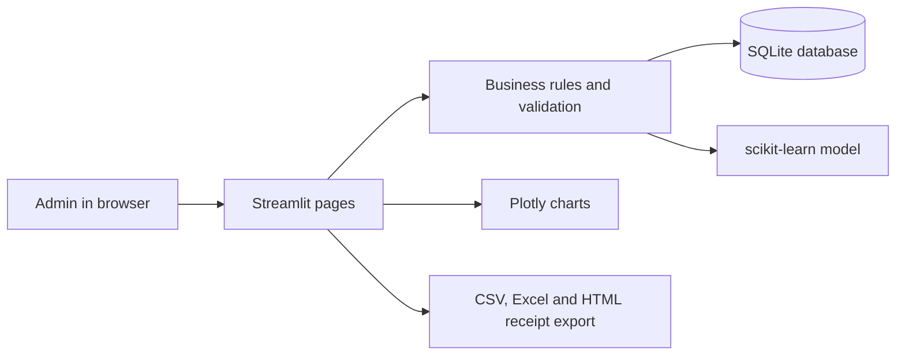
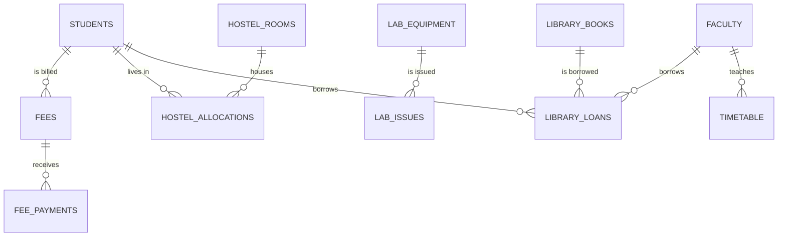

<h1 align="center">🎓 Campus Analytics</h1>

<p align="center">
  <b>A college management and analytics portal: students, faculty, fees, library, hostel, labs and timetable in one dashboard.</b>
</p>

<p align="center">
  
  
  
  
  
  
  
</p>

<!-- After you add screenshots to a /screenshots folder, replace this comment with:
<p align="center"></p>
-->

---

## Table of contents

- [Overview](#overview)
- [Features](#features)
- [Screenshots](#screenshots)
- [Getting started](#getting-started)
- [Try it in 2 minutes](#try-it-in-2-minutes)
- [Architecture](#architecture)
- [Business rules](#business-rules)
- [Security](#security)
- [Machine-learning note](#machine-learning-note)
- [Key engineering decisions](#key-engineering-decisions)
- [Project structure](#project-structure)
- [Troubleshooting](#troubleshooting)
- [Limitations](#limitations)
- [Roadmap](#roadmap)
- [Author](#author)
- [License](#license)

---

## Overview

Most college tools stop at student records. **Campus Analytics** manages the whole campus from a
single admin portal and turns the data into insight: which students need support, which
departments lag, where fees are overdue, and which books or equipment are out.

It is a **16-page Streamlit application** backed by **SQLite**, with analytics in pandas and
Plotly, input validation, secure admin login, and rule-based checks (fines, renewal limits,
bed capacity, timetable clashes) enforced in the data layer rather than only in the interface.

## Features

<details open>
<summary><b>🎓 Students and academics</b></summary>

- **Student Records:** add, search, filter, edit, delete with confirmation, bulk CSV import with a template and per-row error messages
- **Student Profile:** 360° view with college and department rank, comparison against averages, fee balance, library loans, hostel room and next-step tips
- **Academic Performance:** marks distribution, grade breakdown, pass rate, students below the pass mark
- **Attendance:** eligibility against the minimum, department comparison, low-attendance list
- **Department Analysis:** comparison charts and a department × year heatmap
- **At-Risk Students:** low marks and low attendance flags, filters, CSV download
- **Performance Prediction:** Random Forest evaluated with cross-validation against a baseline
</details>

<details open>
<summary><b>🏫 Campus operations</b></summary>

- **Faculty:** directory, status, experience, students-per-faculty ratio by department
- **Fees:** assign to one student or a whole department/year, part payments, overdue tracking, defaulter list, printable receipts
- **Lab Equipment:** inventory, condition tracking, issue and return, low-stock alerts, asset value
- **Library:** issue, **return** and **renew** books with automatic fines, due-soon and overdue lists, loan history
- **Hostel:** rooms and beds by block, occupancy charts, allot and vacate residents
- **Timetable:** weekly grid per department and year, clash detection for faculty and rooms, faculty schedule
</details>

<details open>
<summary><b>📊 Reporting and administration</b></summary>

- **Dashboard:** KPI cards, automatic insights, charts, and a campus operations summary
- **Reports:** CSV per module and one Excel workbook with a sheet for each
- **Admin Settings:** change password, load or remove demo data, database backup download
- **Colour-coded tables:** scores, attendance and statuses (Paid, Overdue, Low stock, Full) are colour-coded so problems stand out
</details>

## Screenshots

<!-- Add your images to /screenshots, then remove this comment and use:
| Dashboard | Student Profile |
|---|---|
|  |  |

| Fees | Library | Timetable |
|---|---|---|
|  |  |  |
-->

*Screenshots coming soon. Run the app with demo data to see every page populated.*

## Getting started

**Requirements:** Python 3.10 or newer.

```bash
git clone https://github.com/<your-username>/campus-analytics.git
cd campus-analytics

python -m venv venv
venv\Scripts\activate            # Windows
# source venv/bin/activate       # macOS / Linux

pip install -r requirements.txt
python -m streamlit run app.py
```

The app opens at `http://localhost:8501`.

**First login:** username `admin`, password `Campus@123`. You are **forced to change the
password** before any other module opens. To choose a different first-run password, set the
`CAMPUS_ADMIN_PASSWORD` environment variable before the first launch.

## Try it in 2 minutes

1. Sign in and set your new password.
2. Open **Admin Settings → Data → Load demo data**. This fills every module with sample records
   (IDs start with `DEMO`, and one click removes them again).
3. **Dashboard:** read the automatic insights and the campus operations row.
4. **Library → Return & Renew:** renew a book, then return an overdue one and watch the fine appear.
5. **Fees → Record Payment:** take a part payment, then download the receipt from the **Receipts** tab.
6. **Timetable → Edit period:** try booking a faculty member who is already teaching at that time.
   The clash is refused.
7. **Student Profile:** pick a student to see everything about them on one page.

## Architecture



### Data model



Twelve tables in total: `students`, `faculty`, `fees`, `fee_payments`, `lab_equipment`, `lab_issues`,
`library_books`, `library_loans`, `hostel_rooms`, `hostel_allocations`, `timetable`, `admins`.

## Business rules

Every rule lives in one settings block at the top of `app.py`. Change it once and every page follows.

| Rule | Default |
|---|---|
| Pass mark | 50% |
| Minimum attendance | 75% (90% and above is "Excellent") |
| Grades | A+ ≥ 90, A ≥ 80, B ≥ 70, C ≥ 60, D ≥ 50, otherwise Fail |
| Library loan period | 14 days for students, 30 days for faculty |
| Renewals | Up to 2, and not allowed when the book is overdue |
| Library fine | ₹2 per day late |
| Book limit | 3 at a time for students; no new loans while a book is overdue |
| Low stock alert | 20% or less of units available |
| Login lockout | 5 failed attempts lock the account for 5 minutes |

## Security

- Passwords are hashed with **PBKDF2-SHA256** (200,000 iterations, random salt per user) and compared in constant time.
- **Account lockout** is stored in the database, so refreshing the page does not reset it.
- The first-run password must be changed before any other module opens.
- All SQL uses **parameterised queries** to prevent SQL injection.
- User-supplied text shown in HTML (names, receipts) is escaped.
- The `.gitignore` keeps the database out of the repository so real student data is never published.

## Machine-learning note

The prediction model estimates a performance category (Needs Attention, Good, Excellent) from
**attendance, year and department only**. Marks are deliberately excluded: the label is derived
from marks, so including them would be *target leakage* and produce impressive-looking but
meaningless accuracy.

Accuracy is measured with **stratified cross-validation** on students the model did not train on, and
compared with a baseline that always guesses the most common class. On small datasets the model may
not beat that baseline, and the app reports this openly instead of hiding it.

## Key engineering decisions

| Decision | Why |
|---|---|
| Business rules enforced in the data layer | A payment cannot exceed the balance, a room cannot exceed capacity, an item cannot be over-issued and a faculty member or room cannot be double-booked, regardless of which screen triggers the action |
| Connections always closed, with commit or rollback | Avoids leaked connections and half-saved changes |
| In-place schema upgrades | Older databases gain new tables and columns without losing data |
| Idempotent demo data | Loading the demo twice never creates duplicates, and removal is one click |
| Honest ML evaluation | Leakage removed; cross-validation against a baseline |
| Settings in one block | Thresholds are never duplicated across pages |

## Project structure

```
campus-analytics/
├── app.py              # the application, organised into clear sections
├── requirements.txt    # Python dependencies
├── README.md
├── LICENSE
├── .gitignore          # keeps real data and local files out of Git
├── screenshots/        # images used in this README
└── database/           # created on first run (ignored by Git)
    └── students.db
```

Inside `app.py`: settings → database → authentication → analytics and ML → theme → reusable UI
pieces → pages → login and app shell.

## Troubleshooting

| Problem | Fix |
|---|---|
| `'streamlit' is not recognized` | Run it through Python: `python -m streamlit run app.py` |
| `No module named ...` | Activate your virtual environment, then `python -m pip install -r requirements.txt` |
| Locked out after failed logins | Wait 5 minutes, or delete `database/students.db` to start fresh (this erases all data) |
| Port already in use | `python -m streamlit run app.py --server.port 8502` |
| Charts or colours look different | Use a recent Streamlit version: `python -m pip install --upgrade streamlit` |

## Limitations

- Single admin account; no roles or per-user permissions.
- SQLite suits one user at a time, not many concurrent users.
- No email or SMS reminders and no online payments. Fee receipts are downloadable HTML files.
- The prediction model is a teaching demo and must not be used for decisions about individual students.
- No automated test suite yet.

## Roadmap

- [ ] Role-based accounts (admin, faculty, accountant)
- [ ] Automated tests with `pytest`
- [ ] Exam schedule and results module
- [ ] Email reminders for overdue fees and library books
- [ ] PostgreSQL support and a Docker setup

## Author

**Suruthi D**

Built as a learning project to practise full-stack data applications: database design,
validation, analytics and honest machine-learning evaluation.

## License

Released under the [MIT License](LICENSE).
