<h1 align="center">🎓 Campus Analytics</h1>

<p align="center">
  <b>A college management and analytics portal: students, faculty, fees, library, hostel, labs and timetable in one dashboard.</b>
</p>

<p align="center">
  
  
  
  
  
  
  
</p>

<!-- After you add screenshots to a /screenshots folder, replace this comment with:
<p align="center"></p>
-->

---

# Campus Analytics – College Performance Management System

A Streamlit-based college performance management system designed to help administrators monitor student records, academic performance, attendance, and institutional analytics through an interactive dashboard.

## Project Overview

Campus Analytics is a web-based application developed using Python and Streamlit. It provides a centralized platform for managing and analysing college-related information.

The application aims to make academic monitoring and administrative data management easier through organized modules, interactive visualizations, and performance insights.

## Technology Stack

| Technology | Purpose |
|---|---|
| Python | Core programming language |
| Streamlit | Web application framework |
| Pandas | Data handling and analysis |
| Plotly | Interactive visualizations |
| Machine Learning | Performance prediction functionality |

## Project Structure

```text
Campus-Analytics/
│
├── app.py
├── requirements.txt
├── README.md
│
├── data/
│
├── assets/
│
└── other project files
```

*The folder structure above is illustrative. Update it to match the actual repository.*


## Project Objectives

- Centralize college-related information.
- Simplify student record management.
- Support academic performance monitoring.
- Present data through interactive visualizations.
- Explore performance prediction and early identification of students requiring support.

## 🚀 Features

- 🎓 **Student Management:** Add, search, edit, delete and manage student records, profiles and academic details.
- 📊 **Academic Analytics:** Track marks, grades, attendance, department performance and at-risk students.
- 🤖 **Performance Prediction:** Predict student performance using a Random Forest machine learning model.
- 👨‍🏫 **Faculty Management:** Maintain faculty details, experience and department-wise statistics.
- 💳 **Fee Management:** Track fee payments, balances, overdue fees and receipts.
- 📚 **Library Management:** Manage books, issues, returns, renewals and fines.
- 🏠 **Hostel Management:** Manage room allocation, occupancy and resident details.
- 🔬 **Lab Inventory:** Track equipment, availability, condition and stock levels.
- 🗓️ **Timetable Management:** Organize schedules and detect faculty and classroom clashes.
- 📈 **Interactive Dashboard:** View key performance indicators, charts and campus insights.
- 📑 **Reports & Export:** Generate CSV reports and Excel workbooks.
- ⚙️ **Admin Settings:** Manage passwords, demo data and database backups.

*Note: Features and modules depend on the functionality implemented in the current project version.*

## Try it in 2 minutes

The app opens at `http://localhost:8501`.

1. Sign in and set your new password.
2. Open **Admin Settings → Data → Load demo data**. This fills every module with sample records
   (IDs start with `DEMO`, and one click removes them again).
3. **Dashboard:** read the automatic insights and the campus operations row.
4. **Library → Return & Renew:** renew a book, then return an overdue one and watch the fine appear.
5. **Fees → Record Payment:** take a part payment, then download the receipt from the **Receipts** tab.
6. **Timetable → Edit period:** try booking a faculty member who is already teaching at that time.
   The clash is refused.
7. **Student Profile:** pick a student to see everything about them on one page.

## Architecture

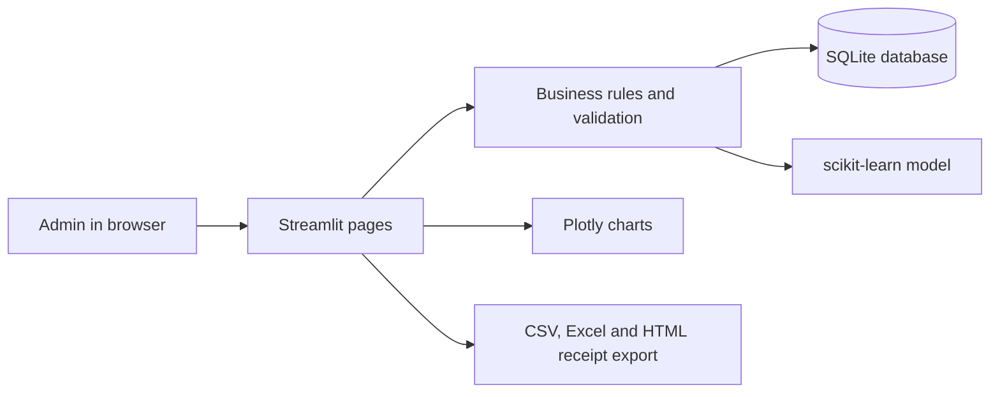

### Data model

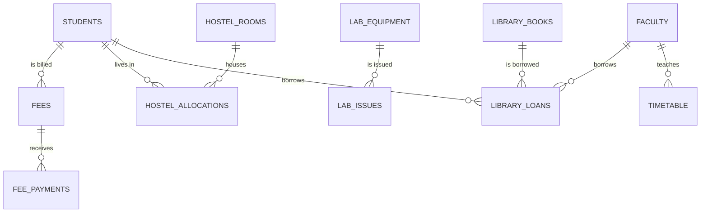

Twelve tables in total: `students`, `faculty`, `fees`, `fee_payments`, `lab_equipment`, `lab_issues`,
`library_books`, `library_loans`, `hostel_rooms`, `hostel_allocations`, `timetable`, `admins`.

## Business rules

Every rule lives in one settings block at the top of `app.py`. Change it once and every page follows.

| Rule | Default |
|---|---|
| Pass mark | 50% |
| Minimum attendance | 75% (90% and above is "Excellent") |
| Grades | A+ ≥ 90, A ≥ 80, B ≥ 70, C ≥ 60, D ≥ 50, otherwise Fail |
| Library loan period | 14 days for students, 30 days for faculty |
| Renewals | Up to 2, and not allowed when the book is overdue |
| Library fine | ₹2 per day late |
| Book limit | 3 at a time for students; no new loans while a book is overdue |
| Low stock alert | 20% or less of units available |
| Login lockout | 5 failed attempts lock the account for 5 minutes |

## Security

- Passwords are hashed with **PBKDF2-SHA256** (200,000 iterations, random salt per user) and compared in constant time.
- **Account lockout** is stored in the database, so refreshing the page does not reset it.
- The first-run password must be changed before any other module opens.
- All SQL uses **parameterised queries** to prevent SQL injection.
- User-supplied text shown in HTML (names, receipts) is escaped.
- The `.gitignore` keeps the database out of the repository so real student data is never published.

## Machine-learning note

The prediction model estimates a performance category (Needs Attention, Good, Excellent) from
**attendance, year and department only**. Marks are deliberately excluded: the label is derived
from marks, so including them would be *target leakage* and produce impressive-looking but
meaningless accuracy.

Accuracy is measured with **stratified cross-validation** on students the model did not train on, and
compared with a baseline that always guesses the most common class. On small datasets the model may
not beat that baseline, and the app reports this openly instead of hiding it.

## Key engineering decisions

| Decision | Why |
|---|---|
| Business rules enforced in the data layer | A payment cannot exceed the balance, a room cannot exceed capacity, an item cannot be over-issued and a faculty member or room cannot be double-booked, regardless of which screen triggers the action |
| Connections always closed, with commit or rollback | Avoids leaked connections and half-saved changes |
| In-place schema upgrades | Older databases gain new tables and columns without losing data |
| Idempotent demo data | Loading the demo twice never creates duplicates, and removal is one click |
| Honest ML evaluation | Leakage removed; cross-validation against a baseline |
| Settings in one block | Thresholds are never duplicated across pages |


## Limitations

- Single admin account; no roles or per-user permissions.
- SQLite suits one user at a time, not many concurrent users.
- No email or SMS reminders and no online payments. Fee receipts are downloadable HTML files.
- The prediction model is a teaching demo and must not be used for decisions about individual students.
- No automated test suite yet.

## Roadmap

- [ ] Role-based accounts (admin, faculty, accountant)
- [ ] Automated tests with `pytest`
- [ ] Exam schedule and results module
- [ ] Email reminders for overdue fees and library books
- [ ] PostgreSQL support and a Docker setup
## Application Grab

### 1. Dashboard
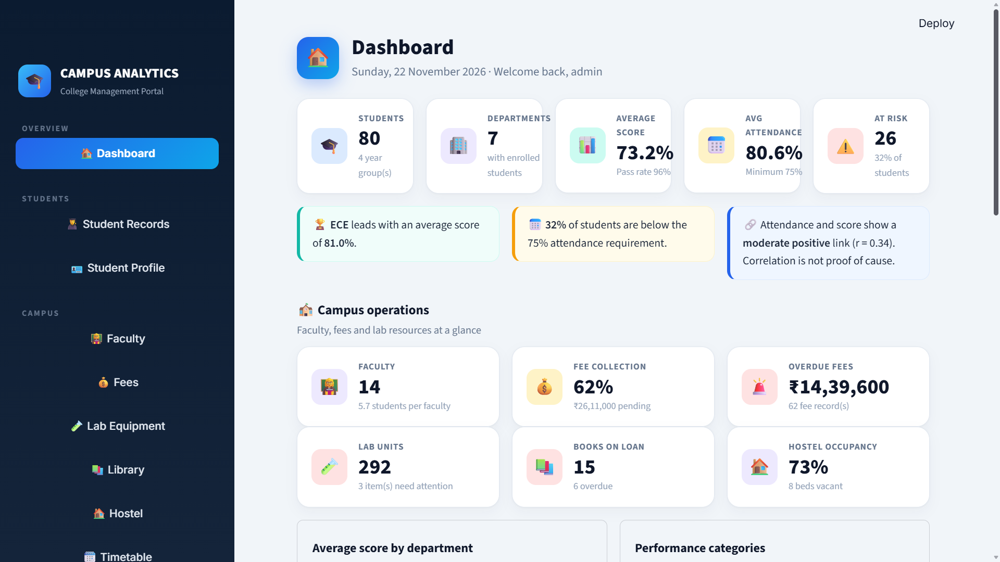

### 2. Student Records
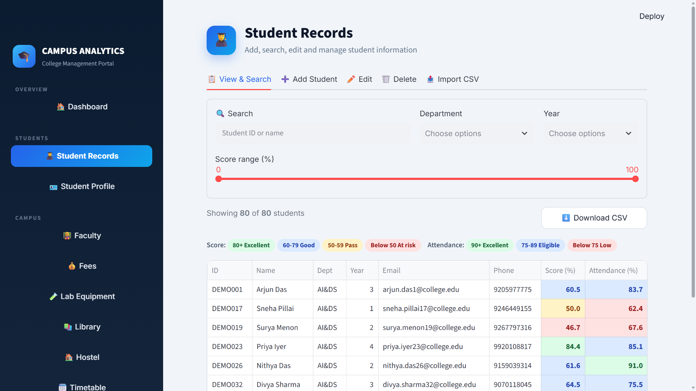

### 3. Student Profile
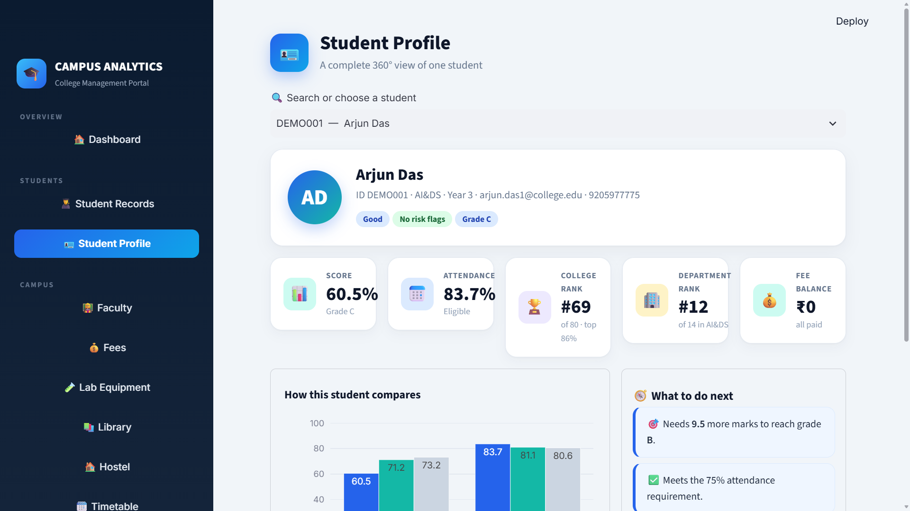

### 4. Faculty
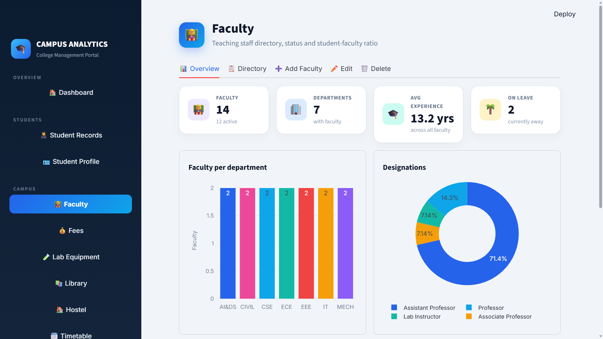

### 5. Fees
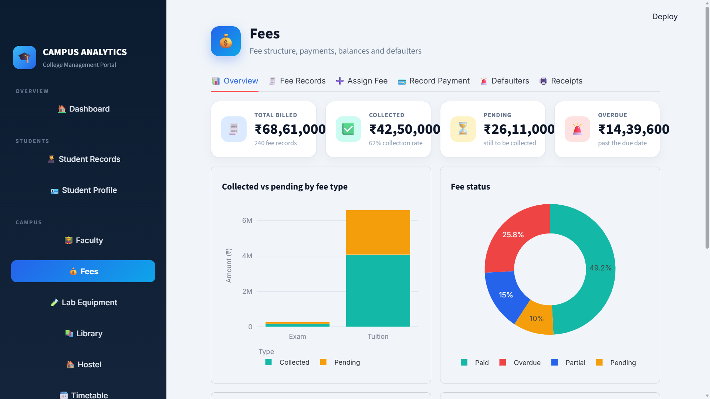

### 6. Lab Equipment
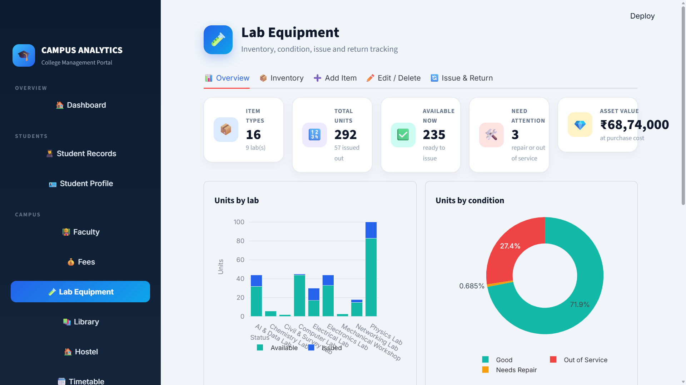

### 7. Library
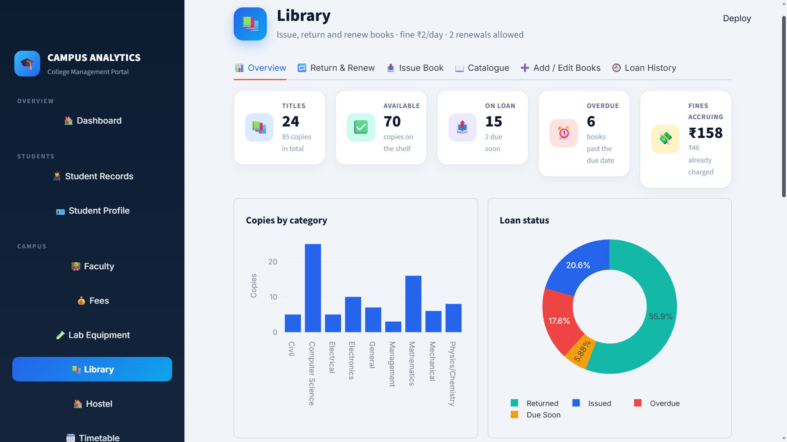

### 8. Hostel
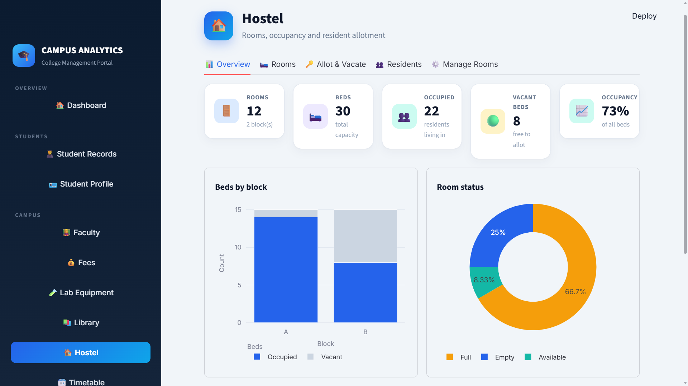

### 9. Timetable
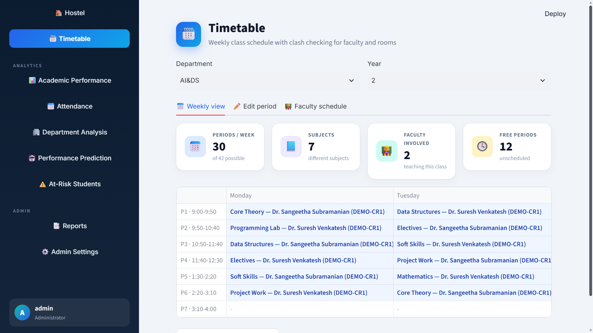

### 10. Academic Performance
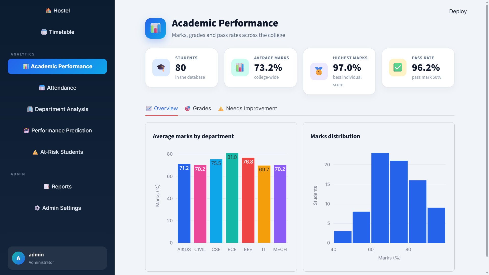

### 11. Attendance
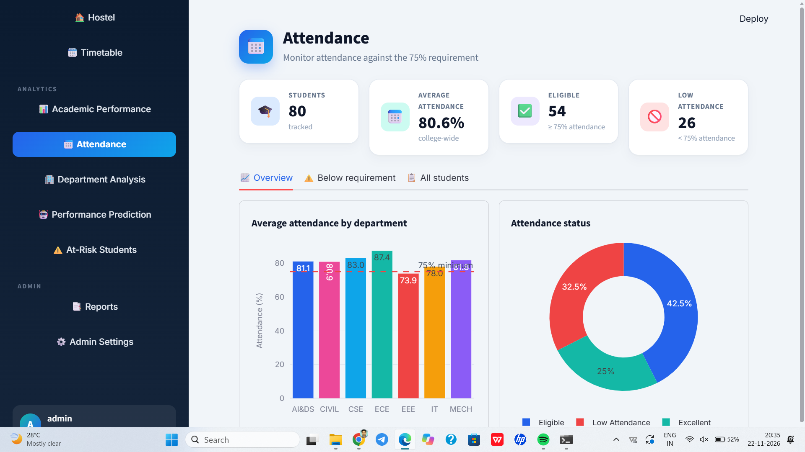

### 12. Department Analysis
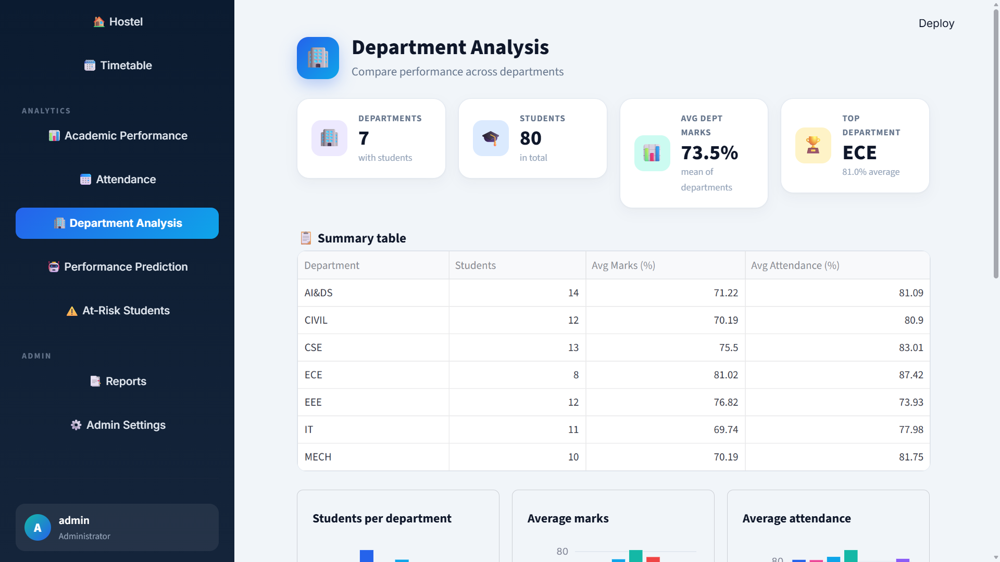

### 13. Performance Prediction
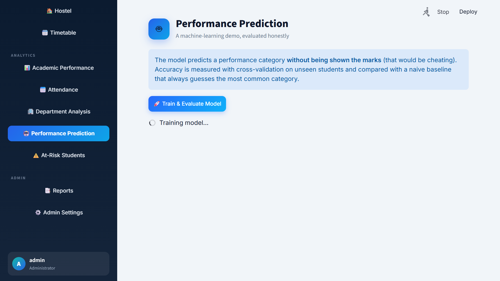

### 14. At-Risk Students
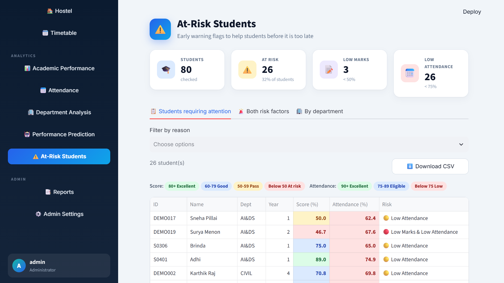

### 15. Reports and Export
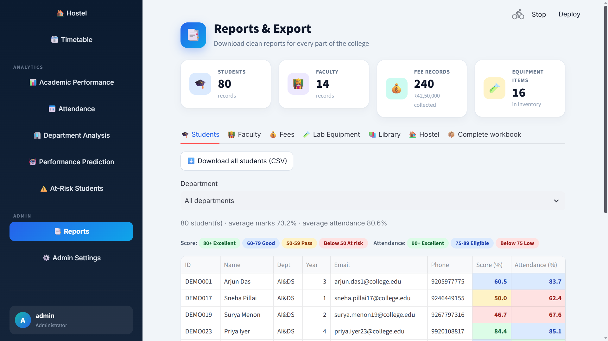

## Application Workflow
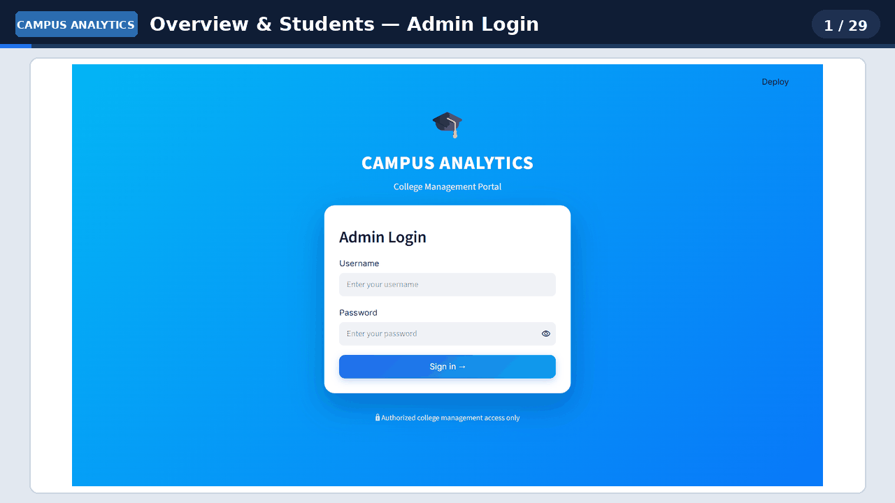

## Author

**Suruthi D** · [GitHub](https://github.com/suruthi-1)

Built as a learning project to practise full-stack data applications: database design,
validation, analytics and honest machine-learning evaluation.

## License

Released under the [MIT License](LICENSE).
